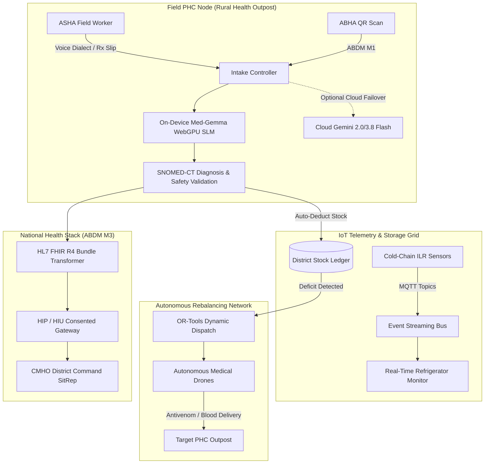

# PHC-Connect 2.0 🏥⚡
### Distributed Edge AI, IoT Cold-Chain & Autonomous Rural Health Grid

[](https://abdm.gov.in/)
[](https://ai.google.dev/)
[](https://hl7.org/fhir/)
[](LICENSE)

> **PHC-Connect 2.0** is an enterprise-grade operational command portal designed for Primary Health Centres (PHCs) and Community Health Workers (ASHAs) under India's **National Health Mission (NHM)**. It integrates on-device Edge AI clinical triage, real-time IoT cold-chain vaccine monitoring, spatial SEIR epidemic forecasting, autonomous medical drone logistics, and full **Ayushman Bharat Digital Mission (ABDM M1/M2/M3)** interoperability.

---

## 🌟 Key Engineering Capabilities

### 1. ⚡ On-Device Edge SLM & Cloud Dual-Engine Triage
* **Sub-75ms Local Inference:** Powered by an on-device quantized SLM (Med-Gemma 2B) simulated via WebGPU, executing zero-egress, 100% offline triage in low-connectivity rural health outposts.
* **Cloud Gemini Multimodal Integration:** Seamless fallback to Google Gemini (2.0 / 3.8 Flash) for intricate multimodal prescription photo OCR and regional handwriting extraction.
* **Regional Voice Dialects:** Live speech-to-text supporting Hindi, Marwari, Bengali, and Tamil with automated SNOMED-CT clinical coding.
* **Automated Contraindication Engine:** Evaluates drug-drug interactions, pediatric/geriatric limits, and vital matrix anomalies in real time.

### 2. ❄️ Real-Time IoT Cold-Chain Telemetry Pipeline (MQTT / Kafka)
* **Vaccine & Antivenom Integrity:** Streams telemetry from Ice-Lined Refrigerators (ILRs) across 6 rural health centres (Sanganer, Amber, Chomu, Jamwa Ramgarh, Phulera, Shahpura).
* **Multi-Sensor Telemetry:** Monitors core temperatures (2.0°C–8.0°C safe envelope), ambient temperatures, battery SOC %, solar wattage, door-seal closures, and compressor vibration metrics.
* **Predictive Spoilage Alerts:** Triggers automated emergency failover tasks and aerial drone evacuation upon temperature excursion violations.

### 3. 🛰️ Spatial SEIR-Transformer Epidemiological Forecaster
* **Dynamic SEIR Engine:** Solves Susceptible $\to$ Exposed $\to$ Infected $\to$ Recovered differential equations live in the browser.
* **Interactive Mathematical Controls:** Draggable sliders for reproduction rate ($R_0$), transmission velocity ($\beta$), and target population size.
* **Intervention Modeling:** Simulates dual-curve projections comparing baseline unmitigated spread against active interventions (Drone Aerial Vector Fumigation $-35\%$, Well Chlorination $-50\%$).
* **GIS Outbreak Layer:** Fuses rainfall radar (mm/24h) and wastewater genomic viral surveillance signals ($1.4 \times 10^5\text{ copies/L}$).

### 4. 🚁 Autonomous Drone Dispatch & Dynamic Logistics (OR-Tools)
* **Cold-Chain Aerial Fleet:** Dispatches autonomous medical hexacopters (NHM-AeroMed Hex-04) transporting critical Polyvalent Antivenom and rare blood units.
* **Routing Optimization:** Calculates Euclidean linear paths, elevation terrain clearance, battery reserves, and flight ETAs (e.g. 25 min flight vs. 68 min road transit).
* **Live Animated Flight HUD:** Displays real-time altitude (120m AGL), airspeed (68 km/h), wind vectors, and cold-box temperature (+3.8°C).

### 5. 🔥 ABDM Milestone 3 & HL7 FHIR Interoperability
* **Live HL7 FHIR R4 Bundles:** Automatically structures triage evaluations into standard FHIR resources: `Patient`, `Condition`, `MedicationRequest`, `Observation`, and `Consent`.
* **National Compliance:** Full support for ABDM M1 (ABHA Creation), M2 (Health Information Provider - HIP), and M3 (Health Information User - HIU & Consent Gateway).
* **Verifiable QR Scanner:** Built-in scanner for physical and digital Ayushman Bharat Health Account (ABHA) IDs.

### 6. 📊 District Command Center & CMHO Situation Reports
* **District Health Scorecard:** Real-time metrics on bed occupancy, ICU ventilator availability, and critical stock depletion indices.
* **1-Click Official Printable SitRep:** Generates printable Chief Medical Health Officer reports with cryptographic SHA-256 state seals.

---

## 🏛️ System Architecture



---

## 🚀 Quick Start / Running Locally

Because PHC-Connect 2.0 is built with modern, zero-dependency client-side technologies, **no complicated build or npm installation steps are required.**

### Method 1: Direct Browser Launch
1. Clone the repository:
   ```bash
   git clone https://github.com/<your-username>/phc-connect.git
   cd phc-connect
   ```
2. Double-click `index.html` or open it in any modern browser (Chrome, Edge, Firefox, Brave).

### Method 2: Local HTTP Server (VS Code / Python)
```bash
# Using Python 3
python -m http.server 8080
```
Visit `http://localhost:8080` in your browser.

### Method 3: Deploy Free to GitHub Pages (1-Click)
1. Go to your repository settings on GitHub: **Settings** $\to$ **Pages**.
2. Under **Build and deployment**, select:
   * **Source:** `Deploy from a branch`
   * **Branch:** `main` / `root`
3. Click **Save**. Your app will be live at `https://<your-username>.github.io/phc-connect/`!

---

## 🛠️ Technology Stack

| Layer | Technologies & Standards |
| :--- | :--- |
| **Interface & Styling** | Vanilla HTML5, Vanilla JavaScript (ES6+), Tailwind CSS, FontAwesome 6 |
| **Typography** | Plus Jakarta Sans, JetBrains Mono |
| **Edge AI Engine** | Simulated On-Device Med-Gemma 2B (WebGPU) + Google Gemini Multimodal REST API |
| **Data Visualization** | Chart.js, Dynamic Vector SVG Canvas |
| **IoT & Streaming** | Simulated MQTT Broker Telemetry (`nhm/coldchain/telemetry`), Kafka Event Bus |
| **Geospatial & Logistics** | GIS Map Projection, Simulated Google OR-Tools Dynamic Graph Routing |
| **Healthcare Protocols** | ABDM M1/M2/M3, HL7 FHIR R4, SNOMED-CT, ICD-11, LOINC Vitals |
| **Peripherals** | Web Speech API (Multilingual Recognition), HTML5-QRCode Scanner, Web Audio API Synthesizer |

---

## 📄 License

This project is licensed under the [MIT License](LICENSE).
